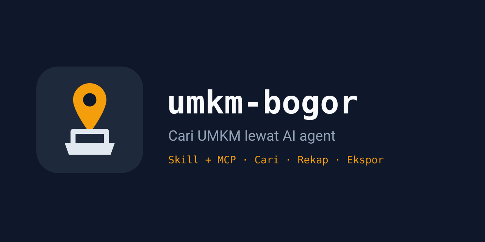

<p align="center">
  
</p>

<h1 align="center">umkm-bogor</h1>

<p align="center"><em>10.891 usaha Kota Bogor lewat CLI dan server MCP — bisa dicari dengan satu perintah.</em></p>

<p align="center">
  
  
  
  
</p>

Telusuri direktori UMKM resmi Kota Bogor (10.891 record) lewat CLI atau server MCP, lalu dapatkan
shortlist usaha nyata lengkap dengan kecamatan, skala usaha, dan koordinat.

```bash
python3 scripts/umkm_bogor.py search --grep "kopi|kue" --limit 10   # 53 kandidat, ~22 detik run pertama
python3 scripts/umkm_bogor.py stats                                 # rekap per kecamatan, ~0,3 detik dari cache
python3 -m unittest discover -s tests -v                            # 18 test
```

Data: `api-solusi.kotabogor.go.id/api/umkm_portal` (publik, tanpa auth). Cache 24 jam di
`$UMKM_CACHE` (default `~/.cache/umkm-bogor`); `--refresh` untuk unduh ulang. Pengayaan (IG/kontak)
adalah langkah manual yang didokumentasikan — dataset tidak punya field kontak.

Pasang sebagai skill Hermes: salin folder ini ke `~/.hermes/skills/<kategori>/umkm-bogor/`.
MCP: daftarkan `python3 <folder>/scripts/mcp_server.py` (stdio, tool `search_umkm`, `stats_umkm`,
`get_umkm`).

Lisensi MIT. Peta file: `SKILL.md` (instruksi agen), `SPEC.md` (checklist penerimaan),
`references/api.md`, `references/shortlist-method.md`, `scripts/`, `tests/`, `assets/`.


