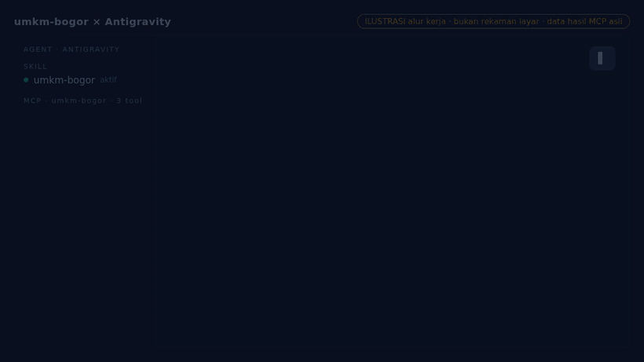

<div align="center">


# umkm-bogor

### Cari UMKM Kota Bogor lewat AI agent, dari data resmi pemkot.

**Tanya pakai bahasa biasa. Agent mencarikan dari data UMKM portal SOLUSI Kota Bogor.**

[](LICENSE)
[](#coba-dari-terminal)
[](#tool-mcp)
[](CHANGELOG.md)

[Pasang](#pasang-di-antigravity) · [Contoh](#contoh-pakai) · [Tool](#tool-mcp) · [Fitur](#fitur) · [Batasan](#batasan) · [Referensi](#referensi)



<sub>Demo ilustrasi: cari UMKM lewat Antigravity.</sub>

</div>

Minta agent kamu "cari produsen kue di Bogor Barat", lalu kamu dapat nama usaha, kecamatan, alamat,
produk, tenaga kerja, omset per bulan, dan koordinat. Repo ini berisi skill (`SKILL.md` + CLI) dan
server MCP. Cukup Python 3.9+, tanpa akun, token, atau paket tambahan.

## Pasang di Antigravity

1. Buka chat Antigravity.
2. Salin prompt ini ke chat:

   ```text
   Pasang skill dari https://github.com/hamgarian/umkm-bogor-mcp-skill supaya bisa dipakai di Antigravity. Baca SKILL.md dan simpan repo beserta skripnya ke folder skill yang didukung versi ini. Kalau sudah terpasang, perbarui instalasi yang ada.
   ```

3. Mulai chat baru dan coba: `Cari UMKM kopi di Bogor dengan minimal 5 pekerja.`

<details>
<summary><strong>Pasang manual (skill atau MCP)</strong></summary>

Ambil kodenya dan catat path absolutnya:

```bash
git clone https://github.com/hamgarian/umkm-bogor-mcp-skill
cd umkm-bogor-mcp-skill
pwd
```

Ganti `/path/ke/umkm-bogor-mcp-skill` di bawah dengan hasil `pwd`.

**MCP di Antigravity.** Buka menu pengelolaan MCP, pilih **View raw config**, lalu tambahkan entri
`umkm-bogor` ke `mcpServers`:

```json
{
  "mcpServers": {
    "umkm-bogor": {
      "command": "python3",
      "args": ["/path/ke/umkm-bogor-mcp-skill/scripts/mcp_server.py"]
    }
  }
}
```

> [!WARNING]
> Kalau file itu sudah berisi server lain, jangan timpa. Sisipkan bagian `"umkm-bogor": { ... }`
> ke `mcpServers` yang ada (pisahkan dengan koma) dan simpan cadangan file lama dulu.

Simpan, reload Antigravity, lalu tanya "ada berapa UMKM per kecamatan?". Agent akan memanggil
`stats_umkm`.

**Skill di Antigravity:**

```bash
mkdir -p ~/.gemini/skills
cp -r /path/ke/umkm-bogor-mcp-skill ~/.gemini/skills/umkm-bogor
```

Hapus dulu folder `umkm-bogor` lama kalau ada, supaya `cp -r` tidak membuat folder bertumpuk.

**Claude Code:**

```bash
claude mcp add --scope user umkm-bogor -- python3 /path/ke/umkm-bogor-mcp-skill/scripts/mcp_server.py
claude mcp get umkm-bogor   # harus: Status: ✔ Connected
mkdir -p ~/.claude/skills && cp -r /path/ke/umkm-bogor-mcp-skill ~/.claude/skills/umkm-bogor   # opsional, sebagai skill
```

**Codex CLI:**

```bash
codex mcp add umkm-bogor -- python3 /path/ke/umkm-bogor-mcp-skill/scripts/mcp_server.py
codex mcp list   # umkm-bogor harus enabled
```

**Cursor dan client lain:** pakai JSON `mcpServers` yang sama (Cursor: `~/.cursor/mcp.json`, atau
`.mcp.json` di root proyek). Aturan menggabungkan konfigurasi di atas tetap berlaku.

**Hermes:** salin folder ke `~/.hermes/skills/research/umkm-bogor` lalu mulai sesi baru. Untuk MCP,
jalankan `hermes mcp add` dan pilih server stdio.

</details>

### Coba dari terminal

```bash
python3 scripts/umkm_bogor.py search --grep "kopi|kue" --limit 5
python3 scripts/umkm_bogor.py stats
```

Run pertama mengunduh sekitar 9,5 MB. Berikutnya CLI membaca cache.

## Contoh pakai

**Supplier kue untuk kafe**

> Pakai umkm-bogor, cari produsen kue di Bogor Barat dengan minimal 5 pekerja. Kasih nama dan alamatnya.

```bash
python3 scripts/umkm_bogor.py search --grep "kue" --kecamatan "Bogor Barat" --min-workers 5 --min-omset 0
```

**Mitra proyek kampus**

> Cari UMKM kopi, mochi, bakso, atau seragam dengan minimal 5 pekerja, urutkan dari yang terbesar.

```bash
python3 scripts/umkm_bogor.py search --grep "kopi|mochi|bakso|seragam" --min-workers 5 --min-omset 0 --sort workers --limit 15
```

**Rekap dan ekspor**

> Ada berapa UMKM per kecamatan? Lalu ekspor usaha batik dan kriya ke CSV.

```bash
python3 scripts/umkm_bogor.py stats
python3 scripts/umkm_bogor.py search --grep "batik|kriya" --csv kerajinan.csv
```

## Tool MCP

| Tool | Fungsi | Parameter (default) |
| --- | --- | --- |
| `search_umkm` | Cari usaha, hasil `{count, rows}` | `grep` (regex), `kecamatan`, `min_workers` (3), `min_omset` (5000000), `sort`, `limit` (20) |
| `stats_umkm` | Jumlah usaha per kecamatan | `min_workers` (3), `min_omset` (5000000) |
| `get_umkm` | Satu data berdasarkan id | `id` (wajib) |

Tiap baris berisi `id`, `name`, `kecamatan`, `alamat`, `produk`, `tenaga_kerja`, `omset_per_bulan`,
`koordinat`, dan `nib`.

## Fitur

- **Satu regex untuk empat kolom:** nama, produk, alamat, kecamatan. Huruf besar dan kecil sama saja.
- **Filter kecamatan dan skala usaha** lewat tenaga kerja atau omset.
- **Data bersih:** baris uji coba, terhapus, di-suspend, belum disetujui, tanpa alamat, dan tanpa
  koordinat dibuang.
- **Urutkan** menurut tenaga kerja, omset, atau nama, lalu **ekspor** ke JSON atau CSV.
- **Cache 24 jam** di `~/.cache/umkm-bogor` (ubah lewat `UMKM_CACHE`, paksa unduh ulang dengan `--refresh`).
- **CLI dan MCP memakai filter yang sama**, jadi jawabannya cocok.

## Batasan

<details>
<summary><strong>Ambang tenaga kerja dan omset memakai OR</strong></summary>

Usaha lolos kalau memenuhi *salah satu* ambang. Default-nya 3 pekerja **atau** omset 5 juta per
bulan. Untuk "minimal 5 pekerja" saja, matikan ambang omset dengan `--min-omset 0` (CLI) atau
`"min_omset": 0` (MCP). Kalau kedua ambang `0`, semua kandidat lolos.

</details>

<details>
<summary><strong>Data, kontak, dan koordinat</strong></summary>

- **Kesegaran:** cache berlaku 24 jam. Server MCP memuat data sekali saat start, jadi reload agent
  setelah cache diperbarui.
- **Kontak:** dataset tidak memuat nomor HP, IG, atau website. Cari manual
  ([`references/shortlist-method.md`](references/shortlist-method.md)); agent tidak boleh mengarang.
- **Koordinat:** sebagian tidak valid (misalnya `1234567i`). Cek format `"lat,long"` sebelum dipetakan.
- **Angka:** tenaga kerja dan omset dilaporkan sendiri oleh pelaku usaha, bukan hasil audit.
- **Cakupan:** hanya Kota Bogor, bukan Kabupaten Bogor.
- **Jaringan:** tool hanya mengunduh dari `api-solusi.kotabogor.go.id` dan menyimpan cache di komputermu.

</details>

## Referensi

- [`SKILL.md`](SKILL.md): instruksi untuk agent
- [`references/api.md`](references/api.md): endpoint, field, dan kualitas data
- [`references/shortlist-method.md`](references/shortlist-method.md): cara memilih mitra atau supplier
- [`scripts/mcp_server.py`](scripts/mcp_server.py): server MCP dan skema tool
- [`CHANGELOG.md`](CHANGELOG.md): riwayat rilis
- Test: `python3 -m unittest discover -s tests -v`

## Lisensi

[MIT](LICENSE). Data milik Pemerintah Kota Bogor (portal SOLUSI). GIF demo dibuat dengan
[remotion-product-motion](https://github.com/hamgarian/remotion-product-motion).
